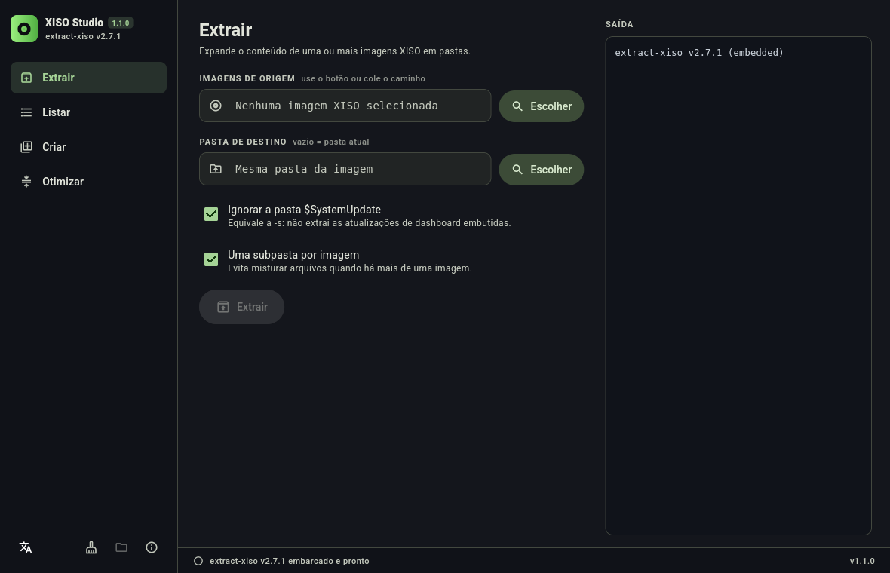

<p align="center">
  
</p>

<h1 align="center">XISO Studio</h1>

<p align="center">
  <em>GUI for the Xbox XISO tool <a href="https://github.com/XboxDev/extract-xiso">extract-xiso</a>
  — extract, list, create and optimize XISO disc images. Ships as a single ELF.</em>
</p>

<p align="center">
  
  
  
  <a href="https://github.com/LucianoSkx/xiso-studio/actions"></a>
  <a href="LICENSE"></a>
</p>

> **Português:** este README continua em português mais abaixo.

## What is it

**XISO Studio** is a desktop app for Linux that wraps
[extract-xiso](https://github.com/XboxDev/extract-xiso) with a modern GUI.

The `extract-xiso` binary (v2.7.1, statically compiled, ~970 KB) is **embedded**
inside the app and is materialized at `~/.cache/xiso-studio/` on first run — you
don't need to install anything else.

The whole app is delivered as **a single ELF file** (AppImage type-2 runtime +
squashfs bundle): no GTK, Dart or Flutter installation required.



## Features

| Mode | What it does | Flags |
|------|--------------|-------|
| **Extract** | Expand one or more images into folders | `-x`, `-s`, `-d` |
| **List** | Inspect the file tree without extracting | `-l` |
| **Create** | Build an image from a folder | `-c`, `-s`, `-m` |
| **Optimize** | Rewrite the filesystem structure to shrink the image | `-r`, `-D`, `-d` |

- Editable path fields (paste a path or pick with a dialog), multi-image batches
  with one subfolder per game.
- **Live progress bar**: the app pre-counts the entries (`-l`) and tracks each
  extracted/added file, showing `12 / 48 files`.
- Real-time log of the tool output, cancel button (SIGTERM), open-output-folder.
- **3 languages** (system/pt-BR/en/es) selectable in the sidebar, persisted in
  `~/.config/xiso-studio/settings.json`. Adding a new language is one `.arb` file.
- App version shown in the sidebar badge and status bar.

## Install / run

Download the latest `XISO-Studio-x86_64.AppImage` from the
[Releases](https://github.com/LucianoSkx/xiso-studio/releases) page:

```bash
chmod +x XISO-Studio-x86_64.AppImage
./XISO-Studio-x86_64.AppImage
```

Requirements at runtime: a Linux x86_64 system with X11 or Wayland and OpenGL.

## Build from source

Requirements: Flutter (Linux desktop), `cmake`, `ninja`, `clang`, `gtk3-dev`,
`squashfs-tools`, `curl`.

```bash
flutter pub get

# debug/run
flutter run -d linux

# release bundle only → build/linux/x64/release/bundle/xiso_studio
flutter build linux --release

# single ELF → dist/XISO-Studio-x86_64.AppImage
./packaging/build-appimage.sh
```

### Update the embedded extract-xiso

```bash
cd ~/Projetos/extract-xiso && git pull
gcc -O2 -D__LINUX__ -static -o assets/bin/extract-xiso extract-xiso.c
./packaging/build-appimage.sh
```

## Quality

`flutter analyze` is clean and the suite (`flutter test`) covers:

- **Unit**: argument building for every mode (including the option-order trap
  around `-c`), progress parsing from real tool output, file counting,
  `$SystemUpdate` skipping.
- **i18n**: all locales share the exact same keys and placeholders.
- **Version**: the displayed version is asserted against `pubspec.yaml`.
- **Widget**: shell renders, language switching (pt → en → es, persisted), the
  progress bar.
- **E2E**: real flows through the UI — type paths, click **Extract**, verify the
  files on disk; and **Create** a real XISO and re-list it with the tool.

CI runs everything on every push
([workflow](.github/workflows/ci.yml)); a tagged `v*` builds the AppImage and
uploads it to the release ([workflow](.github/workflows/release.yml)).

## Project layout

```
lib/main.dart      shell: theming (Xbox-green), sidebar, log panel, status bar
lib/pages.dart     the four modes
lib/widgets.dart   PathPicker, OptionTile, LogPanel, ProgressStrip
lib/state.dart     AppState: execution, progress, log, cancellation
lib/args.dart      pure, testable argument builders
lib/xiso.dart      embedded-tool extraction + process runner + progress parsing
lib/l10n/*.arb     translations (pt, en, es)
packaging/         AppImage script, icon (SVG source + PNGs), runtime
assets/bin/        the statically-linked extract-xiso
```

## License

App: [MIT](LICENSE) © 2026 LucianoSkx.

`extract-xiso` is by *in* &lt;in@fishtank.com&gt; / the XboxDev organization, under
its own license ([NOTICE-extract-xiso.txt](NOTICE-extract-xiso.txt)). This project
is an independent front-end and is **not affiliated with Microsoft**; Xbox is a
trademark of Microsoft Corporation.

---

# Português

## O que é

**XISO Studio** é um aplicativo de desktop para Linux que embrulha o
[extract-xiso](https://github.com/XboxDev/extract-xiso) numa interface gráfica
moderna.

- O binário do `extract-xiso` v2.7.1 (compilado estático, ~970 KB) vai
  **embutido** no app e é materializado em `~/.cache/xiso-studio/` no primeiro
  uso.
- O app inteiro é entregue como **um único ELF** (AppImage): não é preciso
  instalar GTK, Dart nem Flutter.
- Quatro modos: **Extrair**, **Listar**, **Criar** e **Otimizar**, com
  **barra de progresso em tempo real**, log da saída, cancelamento, caminhos
  editáveis e suporte a lote.
- **3 idiomas**: sistema, português (BR), inglês e espanhol — trocáveis na
  barra lateral e persistidos em `~/.config/xiso-studio/settings.json`.

## Uso

```bash
chmod +x XISO-Studio-x86_64.AppImage
./XISO-Studio-x86_64.AppImage
```

Escolha o arquivo `.iso`/`.xiso` (ou cole o caminho), decida a pasta de destino
e clique em **Extrair**. A aba **Criar** monta uma imagem a partir de uma pasta
com o conteúdo do jogo; **Otimizar** reescreve a imagem para reduzir o tamanho.

## Build

```bash
flutter pub get
flutter run -d linux            # desenvolvimento
./packaging/build-appimage.sh   # ELF único em dist/ (rode os testes no CI)
```

## Testes e QA

```bash
flutter analyze && flutter test
```

A suíte cobre argumentos, parsing de progresso, traduções, versão, troca de
idioma na UI e fluxos de ponta a ponta (extração e criação reais pela
interface). Toda alteração roda o CI automático.

## Licença

App: [MIT](LICENSE) © 2026 LucianoSkx. O `extract-xiso` pertence a *in* /
XboxDev com licença própria ([NOTICE-extract-xiso.txt](NOTICE-extract-xiso.txt)).
Projeto independente, **não afiliado à Microsoft**; Xbox é marca registrada da
Microsoft Corporation.